<p align="center">
  
</p>

<h1 align="center">ScreenAlign</h1>

<p align="center">
  <strong>Line up your Mac's screens by eye, so the cursor moves between them at the exact height you see.</strong>
</p>

<p align="center">
  <a href="https://github.com/tomacco/screen-align/actions/workflows/ci.yml"></a>
  
  
  <a href="LICENSE"></a>
</p>

---

## The problem

System Settings > Displays > Arrange lets you drag small rectangles around. Their size has nothing to do with the physical size of your screens, so the result is a guess. When the guess is off, the cursor jumps up or down every time it crosses from one screen to the next.

ScreenAlign covers each screen with a line. You move the lines until they look like one straight line across the bezels, press Return, and macOS stores the arrangement that makes it true. It writes through the public Core Graphics display API with the permanent option, so the result survives logout and reboot.

## Install

With [Homebrew](https://brew.sh):

```bash
brew install --cask tomacco/tap/screen-align
```

Or download `ScreenAlign.zip` from the [latest release](https://github.com/tomacco/screen-align/releases/latest), unzip it and move `ScreenAlign.app` to Applications.

The app is not notarized yet, so the first launch needs one extra step: right-click the app, choose **Open**, then **Open** again. Or run:

```bash
xattr -dr com.apple.quarantine /Applications/ScreenAlign.app
```

To build it yourself, see [Build from source](#build-from-source).

## Use

1. Open ScreenAlign. Every screen gets a dark overlay with an amber line.
2. Drag each line, or select it and use the arrow keys, until all lines read as one continuous line across the bezels. The built-in screen (the main display) is the reference and does not move.
3. Press **Return**. The arrangement is written immediately.
4. Press **T** and move the mouse across the bezel. The dashed cursor line should land on the amber line on every screen.

| Key | Action |
|-----|--------|
| Drag, or arrows | Move the selected line by 1 pt (hold Shift for 10 pt) |
| Tab | Select the next line, across lines and screens |
| N / Delete | Add a line / remove the selected line |
| V | Switch between horizontal lines (screens side by side) and vertical lines (screens stacked) |
| T | Show or hide the cursor line |
| B | Change the background darkness |
| Return | Write the arrangement |
| U | Undo the last write |
| Esc | Quit |

### Stacked screens

When one screen sits above another, ScreenAlign starts with vertical lines and corrects the left and right offset. With a mix of side-by-side and stacked screens, do one pass with horizontal lines and one with vertical lines (press V).

### Several lines and scale mismatch

Put one line near the top of the screens and one near the bottom. If they need different corrections, the screens do not have the same physical size per point. The panel shows the difference. No arrangement can fix that: the cursor can match at one height only, and ScreenAlign writes the average. Picking a different scaled resolution for one of the screens in System Settings brings the two closer.

## How it works

The arrangement is a set of screen origins in one global coordinate space. A line at the same global height on two screens is a line the cursor crosses without a jump. ScreenAlign reads where your lines are on each screen, computes the shift that puts them at the same global height as the line on the main display, and writes the new origins with `CGConfigureDisplayOrigin` and `CGCompleteDisplayConfiguration(.permanently)`.

Details, the coordinate spaces and the limits are in [docs/how-it-works.md](docs/how-it-works.md).

## Build from source

Requires macOS 13 or later and Swift 5.10 or later (Xcode or the Command Line Tools).

```bash
git clone https://github.com/tomacco/screen-align.git
cd screen-align
make test       # unit tests for the alignment logic
make install    # builds a universal ScreenAlign.app into ~/Applications
make run        # installs and opens it
```

## Project layout

```
Sources/ScreenAlignCore/   alignment logic, no AppKit, fully unit tested
Sources/ScreenAlign/       the app: overlay windows, drawing, input, Core Graphics boundary
Tests/                     swift-testing suites against a fake display arrangement
scripts/build-app.sh       builds and signs the .app bundle
```

## Contributing

Issues and pull requests are welcome. The code follows [Primera Plana](https://github.com/tomacco/primera-plana): public methods read as a short list of named steps, and the detail lives in private leaves below them. Read [CONTRIBUTING.md](CONTRIBUTING.md) before opening a pull request.

## Releasing

Push a tag such as `v1.1.0`. The release workflow tests, builds a universal app, attaches the zip to a GitHub release and, when the Apple signing secrets are set, signs and notarizes it. Steps in [docs/releasing.md](docs/releasing.md).

## License

[MIT](LICENSE)
